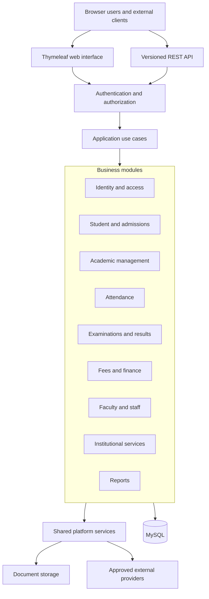

# 04 — Target Architecture

## 1. Recommended approach

Retain Spring Boot as a **modular monolith** for the foreseeable future. Organize code by business capability rather than allowing all new functionality to accumulate in generic controller/service/repository folders.

A modular monolith is one deployable application with explicit module boundaries and controlled communication between modules.

## 2. Logical architecture



## 3. Suggested package structure

Adapt incrementally; do not move the entire codebase in one change.

```text
com.studentmanagement
├── StudentManagementSystemApplication.java
├── shared
│   ├── config
│   ├── security
│   ├── exception
│   ├── audit
│   ├── notification
│   ├── document
│   └── web
├── identity
│   ├── web
│   ├── application
│   ├── domain
│   └── infrastructure
├── student
│   ├── web
│   ├── application
│   ├── domain
│   └── infrastructure
├── admission
├── institution
├── academic
├── attendance
├── examination
├── finance
├── staff
├── timetable
├── library
├── hostel
├── transport
├── placement
└── reporting
```

Each module should contain only the layers it needs:
- `web`: MVC controllers, REST controllers and request/response DTOs.
- `application`: use cases, orchestration and transaction boundaries.
- `domain`: business entities, value objects and domain rules.
- `infrastructure`: JPA repositories, persistence adapters and provider integrations.

Do not create empty packages for every future module immediately.

## 4. Module ownership and boundaries

| Module | Owns | Must not own |
|---|---|---|
| Identity | Accounts, roles, permissions, sessions | Student academic data |
| Institution | Institution, campus, departments, configuration | Individual student lifecycle |
| Student | Student profile, contacts and lifecycle | Fee ledger or exam marks |
| Admission | Applications, admission decisions and admission documents | Long-term academic results |
| Academic | Programs, courses, terms, classes, sections and subjects | Payment transactions |
| Attendance | Attendance sessions and attendance records | Student master identity |
| Examination | Exams, assessment components, marks and results | Fee collection |
| Finance | Fee plans, invoices, payments, concessions and refunds | Academic enrollment ownership |
| Staff | Staff profiles, employment and faculty allocation | Student identity |
| Timetable | Time slots, rooms, schedules and allocations | Exam grading |
| Shared services | Audit, documents, notifications, workflow primitives | Module-specific business decisions |

## 5. Module communication rules

- Modules may call published application services or defined interfaces.
- Avoid direct access to another module's repositories.
- Avoid circular dependencies.
- Share IDs and stable contracts rather than exposing mutable JPA entities.
- Use domain/application events for decoupled follow-up work where useful.
- Keep event handling transactional and idempotent.
- Do not introduce a message broker until asynchronous volume or reliability requirements justify it.

## 6. Transaction design

- A single business use case should define its transaction boundary.
- A fee payment, for example, must not be marked successful unless the payment record and relevant ledger updates are consistent.
- External provider calls should not hold database transactions open unnecessarily.
- Use idempotency keys for payment callbacks and other retried external requests.
- Define compensating actions for workflows that span external systems.

## 7. Deployment direction

Initially:
- One Spring Boot deployable.
- One relational database.
- One managed document-storage approach.
- External integrations behind provider interfaces.

Later options, only when justified:
- Separate read/reporting workload.
- Cache for measured hot paths.
- Background worker for long-running jobs.
- Separate service for a module with independent scaling or ownership requirements.

## 8. Architecture acceptance criteria

- No circular module dependencies.
- Controllers do not contain business rules.
- Public API contracts do not expose persistence entities.
- Cross-module operations use documented interfaces.
- Database migrations are the only production schema-change mechanism.
- Module boundaries are covered by architecture tests or code-review rules.
