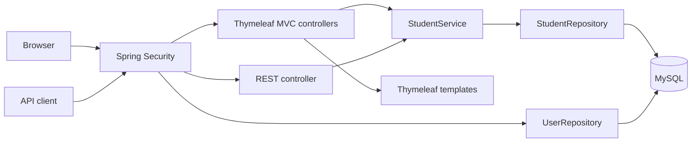
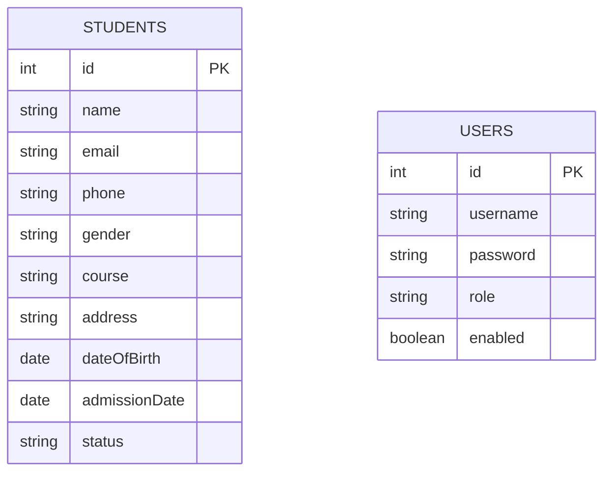
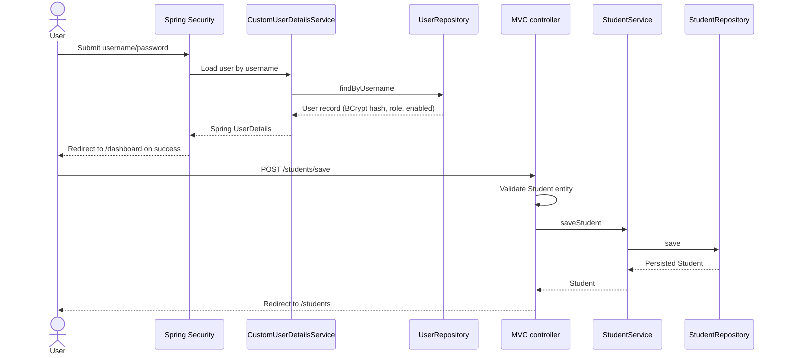

# System analysis and technical vision

**Assessment basis:** checked-in project source and configuration reviewed on 2026-11-26. This document distinguishes the system that exists from recommendations; proposed capabilities are not represented as delivered features.

## 1. Current system (AS-IS)

### 1.1 Overview

The Student Management System is a single Spring Boot application. It renders browser pages with Thymeleaf and Bootstrap, authenticates browser users with Spring Security form login, and exposes a separate JSON API for student records. Both interfaces use the same service, repository, JPA entity, and MySQL database.

The deployed unit is a server-side Java application, not a separate frontend/API deployment or a microservice suite. Flyway manages database migrations and Docker Compose defines the local app/MySQL stack. There is no separate API contract generator, CI pipeline, or external integration configured in the reviewed repository.

### 1.2 Technology stack

| Area | Present in repository |
| --- | --- |
| Language/runtime target | Java 17 (`pom.xml`) |
| Framework | Spring Boot 4.1.0, Spring MVC |
| Browser rendering | Thymeleaf; Bootstrap 5.3.3 loaded from jsDelivr in templates |
| Authentication | Spring Security form login; custom `UserDetailsService`; BCrypt password encoder |
| Persistence | Spring Data JPA and Hibernate |
| Database driver | MySQL Connector/J; JDBC connection settings supplied through environment variables |
| Validation | Jakarta Bean Validation annotations on `Student`; Spring validation starter |
| Build | Maven Wrapper, Maven distribution 3.9.16 |
| Tests | Spring Boot test dependencies, a context-load test, and focused MVC/security tests |

No separate JavaScript application, frontend build tool, API documentation generator, cache, message broker, observability stack, or AI integration is configured.

### 1.3 Architecture

The code follows a lightweight layered structure. MVC and REST controllers handle HTTP, `StudentService` centralizes operations, Spring Data repositories perform persistence, and JPA entities represent database records. `LoginController` also supplies dashboard counts. `SecurityConfig` and `DataInitializer` are application configuration.



### 1.4 Implemented modules

| Module / location | Status | Responsibility and observed boundaries |
| --- | --- | --- |
| `config/SecurityConfig.java` | Implemented, interim policy | Form login, logout, BCrypt, CSRF, authenticated API reads, ADMIN-only writes, and ADMIN-only student mutations. |
| `config/DataInitializer.java` | Implemented, environment-driven | Creates configured ADMIN and optional USER accounts only when the users table is empty. Passwords are BCrypt-encoded; there are no built-in credentials. |
| `controller/LoginController.java` | Implemented | Serves login and dashboard. Dashboard reads total, Active, and Inactive counts from the service. |
| `controller/StudentController.java` | Implemented, limited | Serves student list, add/edit/save/delete, and name search. List pagination is fixed at five records; delete uses POST. |
| `rest/StudentRestController.java` | Implemented, limited | Authenticated CRUD and name search under `/api/students`; uses request/response DTOs and standard status/error responses. |
| `service/StudentService{,Impl}.java` | Implemented | Delegates student persistence/search and provides student counts; contains no transaction boundary or additional domain rules. |
| `repository/StudentRepository.java` | Implemented | Uses `JpaRepository`; adds case-insensitive contains search and count-by-status. |
| `repository/UserRepository.java` | Implemented | Uses `JpaRepository`; adds username lookup. |
| `entity/Student.java` | Implemented | Student fields, identity ID, table name, and basic validation constraints. |
| `entity/User.java` | Implemented, limited | Username, password, role string, enabled flag; username is non-null and unique in the current schema. |
| `security/CustomUserDetailsService.java` | Implemented | Loads a persisted user by username, maps role using Spring's `roles(...)` convention, and respects `enabled`. |
| `exception/GlobalExceptionHandler.java` | Implemented, limited | Maps missing browser student records to a safe 404 page. API errors use a separate problem-details handler. |
| `resources/templates/` | Implemented | Login, dashboard, student list, student form, and generic error pages. Layout/style is inline; Bootstrap CSS is fetched from a CDN. |
| `src/test/java/...` | Partial | Context-load test and focused MVC tests for API authentication, roles, CSRF, and DTO responses; service/repository and migration upgrade tests remain to be added. |

### 1.5 Current capabilities and status

| Capability | Status | Evidence / qualification |
| --- | --- | --- |
| User login/logout | Implemented | Database-backed form login and logout configuration. |
| Student create and edit | Implemented | MVC form plus API POST/PUT; entity validation is applied at both entry points. |
| Student listing | Implemented, limited | MVC list paginates at five rows; API returns the full list. |
| Student delete | Implemented | MVC deletion uses POST with CSRF; API deletion uses DELETE with authentication, authorization, and CSRF. |
| Name search | Implemented, limited | Case-insensitive substring query. MVC search has no pagination metadata, unlike the list template's expectations. |
| Dashboard counts | Implemented | Total records and exact status counts for `"Active"` and `"Inactive"`. |
| Validation | Partial | Required values and email format are checked. No phone format/length, date ordering, email uniqueness, allowed-value domain validation, or database uniqueness constraints are declared. |
| Role-specific student permissions | Interim | Authenticated users can read student pages/API; only ADMIN can open write forms or mutate student records. Confirm the full institution permission matrix before production. |
| API authentication | Implemented, interim | All `/api/**` requests require authentication; reads are available to authenticated roles and writes require ADMIN. Session/CSRF authentication is not intended as a third-party API strategy. |
| API pagination/versioning/contract | Missing | API list/search return unpaged entity lists; no version prefix or OpenAPI contract is present. |
| Account administration, registration, password reset | Missing | No corresponding controller or workflow was found. |
| Audit trail, reporting/export, student-course enrollment model | Missing | No audit entities, export flow, or related domain entities were found. |

### 1.6 User roles and access behavior

On a fresh/empty users table, `DataInitializer` requires externally configured `APP_BOOTSTRAP_ADMIN_USERNAME` and `APP_BOOTSTRAP_ADMIN_PASSWORD`; an optional USER account uses the matching `APP_BOOTSTRAP_USER_*` variables. There are no built-in passwords, and populated tables are not changed by bootstrap.

| Request category | Configured access |
| --- | --- |
| `/login`, `/css/**`, `/js/**`, `/images/**` | Public |
| `GET /api/**` | Requires authentication |
| Non-GET `/api/**` | Requires `ADMIN` and a valid CSRF token |
| `GET /students/add`, `GET /students/edit/**` | Requires `ADMIN` |
| `POST /students/**` | Requires `ADMIN` and a valid CSRF token |
| `/admin/**` | Requires `ADMIN` role |
| `/user/**` | Requires `ADMIN` or `USER` role |
| Everything else | Requires authentication |

The current policy is intentionally minimal: authenticated USER accounts can read student data, while ADMIN accounts can manage it. User/account management and institution-specific permissions are not implemented.

### 1.7 Database structure

Two JPA entities map to tables named `students` and `users`. Both use generated integer identity IDs. There are no JPA relationships between them and no declared foreign keys. The diagram shows only entity fields represented in code; exact SQL column types, nullability, and indexes are generated by Hibernate and the database dialect and are not maintained as explicit migration DDL.



| Table/entity | Fields | Constraints in application code |
| --- | --- | --- |
| `students` / `Student` | `id`, `name`, `email`, `phone`, `gender`, `course`, `address`, `dateOfBirth`, `admissionDate`, `status` | Generated ID; all listed business fields except `id` have validation constraints. Email uses `@Email` and `@NotBlank`; text fields use `@NotBlank`; both dates use `@NotNull`. `LocalDate` form binding uses `yyyy-MM-dd`. |
| `users` / `User` | `id`, `username`, `password`, `role`, `enabled` | Generated ID; username is non-null and unique. No roles table or account-management workflow is implemented. |

Datasource URL/user/password are configured outside source control. Flyway manages versioned migrations, baselines a non-empty legacy schema at version 1, and Hibernate uses `ddl-auto=validate`. SQL logging is disabled by default. See [Database migrations and legacy-data readiness](./database-migration-and-inventory.md) for preflight, backup, and recovery steps.

### 1.8 HTTP interfaces

#### Browser routes

All routes below other than login and configured static paths require authentication. The route behavior is taken from the MVC controllers.

| Method | Path | Behavior |
| --- | --- | --- |
| `GET` | `/login` | Renders login form. Spring Security processes form login. |
| `GET` | `/dashboard` | Renders total, Active, and Inactive counts. |
| `GET` | `/students?page={page}` | Renders a zero-based page of five students; default page is `0`. |
| `GET` | `/students/add` | Renders an empty student form for ADMIN. |
| `POST` | `/students/save` | Validates and saves the bound student; redirects to `/students` on success. |
| `GET` | `/students/edit/{id}` | Looks up a student and renders the form for ADMIN. |
| `POST` | `/students/delete/{id}` | Deletes and redirects; ADMIN and CSRF required. |
| `GET` | `/students/search?name={name}` | Returns case-insensitive name matches to the student-list template. |
| `POST` | `/logout` | Spring Security logout; redirects to `/login?logout`. |

#### JSON API

All endpoints require authentication. Read operations are available to authenticated roles; state-changing operations require ADMIN and CSRF.

| Method | Path | Behavior |
| --- | --- | --- |
| `GET` | `/api/students` | Returns all students in one response. |
| `GET` | `/api/students/{id}` | Returns a response DTO or a 404 Problem Detail. |
| `POST` | `/api/students` | Validates a request DTO and returns 201 with a response DTO. |
| `PUT` | `/api/students/{id}` | Validates a request DTO and updates the resource selected by the path ID. |
| `DELETE` | `/api/students/{id}` | Deletes by ID and returns 204. |
| `GET` | `/api/students/search?name={name}` | Returns all matching students; no page/size controls. |

The response DTO includes current student fields and an ID; request DTOs cannot assign the database ID. Dates are `LocalDate` values represented in ISO date form, e.g. `2004-05-15`. Validation errors and missing records return safe Problem Detail responses rather than exception messages.

### 1.9 Main workflows

#### Browser login and student form flow



#### API create flow

```mermaid
sequenceDiagram
    actor Client
    participant Security as Spring Security
    participant API as StudentRestController
    participant Service as StudentService
    participant Repo as StudentRepository
    participant DB as MySQL

    Client->>Security: POST /api/students (JSON)
    Note over Security: Authenticated user required; ADMIN and CSRF required for writes
    Security->>API: Dispatch request
    API->>API: Validate request entity
    API->>Service: saveStudent
    Service->>Repo: save
    Repo->>DB: Insert/update entity
    DB-->>Client: Serialized Student response
```

## 2. Gap analysis

The following are observations from the current checkout, not claims about external deployments.

| Priority | Area | Current gap / risk | Recommended direction |
| --- | --- | --- | --- |
| Critical | API access control | Resolved in current code: authentication required; ADMIN-only writes and regression tests added. Third-party API auth remains unselected. | Select an API authentication strategy before serving external clients; retain role and CSRF tests. |
| Critical | CSRF and browser mutations | Resolved in current code: session CSRF is enabled; MVC delete is POST and API writes require CSRF. | Keep all state changes on non-GET methods and covered by CSRF tests. |
| High | Default credentials/secrets | Resolved in current code: datasource/bootstrap secrets are environment-provided; no built-in accounts are created. Older database accounts still require explicit rotation. | Manage secrets through deployment tooling and rotate legacy credentials. |
| High | Authorization model | Interim USER-read/ADMIN-write policy is enforced on student pages/API with tests. | Obtain approval for a complete institution permission/data-scope model. |
| High | Error handling | Student missing-record errors are sanitized and mapped to 404; API validation/not-found/conflict handlers return Problem Details. | Add operational structured logging/correlation and extend error mappings as features grow. |
| High | Missing-record handling | Resolved for student reads/updates/deletes through explicit not-found exceptions and 404 mappings. | Keep not-found behavior consistent as new resources are added. |
| High | Schema lifecycle | Flyway versioned migrations and Hibernate schema validation are enabled. Existing-database inventory and backup/restore still require operator execution against the target database. | Run and review the read-only inventory, verify backup/restore, and test the upgrade against a representative database copy. |
| Medium | MVC search/list behavior | Search renders `students.html`, which expects `currentPage` and `totalPages`, but search supplies only `students`. Empty results and pagination state may not render coherently. | Use one list view model for search and listing; add focused view/controller tests. |
| Medium | Input/domain validation | Phone is any nonblank text; dates are not checked for chronology; gender/status values are not enforced for API callers; email is not unique. | Add validated request DTOs, domain rules, length/range constraints, and database uniqueness where business rules require them. |
| Medium | API design | DTOs and predictable delete/error responses are implemented; API still has no pagination, versioning, or OpenAPI contract. | Add bounded pagination and a documented/versioned API contract. |
| Medium | Performance | REST get-all and search are unbounded; name substring matching can become expensive as data grows; no indexes or measurements are specified. | Establish expected data volumes, add bounded pagination, inspect query plans, index measured query patterns, and monitor database latency. |
| Medium | Test coverage | MVC/security behavior is tested; service/repository and real-database migration-upgrade coverage remain limited. | Add migration and repository integration tests using the production database engine. |
| Low | Operational readiness | No production profile, health/metrics, structured logging policy, containerization, CI/CD, or documented operations workflow is present in the checkout. | Add environment-specific config and delivery/operations automation once deployment targets are selected. |
| Low | Maintainability | Student/security services use constructor injection; the test-error route and student PII debug writes were removed. Other packages may still contain field injection or debug output. | Continue incremental constructor-injection cleanup and static analysis. |
| Low | UI maintainability/accessibility | UI refresh work is tracked separately; destructive student deletion now submits a CSRF-protected POST form. | Continue the UI refresh and maintain non-GET mutation semantics. |

## 3. Future vision (TO-BE)

These are recommendations and should be selected based on product, privacy, and deployment requirements; none are currently implemented unless already identified above.

### 3.1 Product modules

1. **User and access administration:** managed accounts, role assignment, account disablement, password reset, and auditable access changes.
2. **Academic structure:** courses/programs as managed records, academic terms, sections, and explicit student-course enrollment relationships rather than free-text course values.
3. **Student lifecycle:** enrollment status history, document/attachment metadata, guardian/contact records where legally appropriate, and controlled archive/deactivation.
4. **Reporting and export:** filtered reports, CSV export, and operational dashboards with authorization and privacy controls.
5. **Audit and notifications:** record who changed sensitive records and when; optionally integrate email for approved workflow notifications.

### 3.2 Platform and architecture evolution

- Preserve the current monolith until independent scaling, ownership, or deployment needs justify service decomposition. First strengthen module boundaries and avoid sharing persistence entities as API contracts.
- Add DTOs and explicit application/domain validation; use service-level transaction boundaries for multi-step operations.
- Adopt a versioned database migration tool and a tested backup/restore plan before production data is relied on.
- Secure the browser and API intentionally: CSRF for cookie/session-authenticated forms; API authentication (for example, an organization-approved OAuth2/OIDC resource-server approach) and least-privilege scopes/roles; TLS at the deployment edge.
- Add bounded API pagination/filter/sort, database indexes guided by query plans, and load tests against agreed record volumes.
- Add production profiles, externalized secrets, health/readiness endpoints, metrics, structured logs, centralized error correlation, and alerting according to a chosen hosting environment.
- Automate formatting/static analysis, tests, dependency/security checks, build artifact creation, and controlled deployment in CI/CD. Add container or platform packaging only after the target runtime is agreed.
- Add accessibility, responsive UI, localization, and browser-level checks according to user needs.

### 3.3 Integrations and AI possibilities

Potential integrations, subject to requirements and governance:

- Institutional identity provider (SSO), directory, or approved email service.
- Student information system import/export with idempotent reconciliation and explicit data ownership.
- Analytics/reporting platform with minimized or de-identified data.
- AI-assisted natural-language search, duplicate-record suggestions, or aggregate trend summaries could be explored only after data quality, privacy, consent, access controls, retention, and human-review rules are defined. AI should not make consequential student eligibility or disciplinary decisions autonomously. No AI capability or AI dependency exists in the current repository.

## 4. Development roadmap

Phases are ordered by risk and dependency, not calendar estimates. Confirm product rules, deployment model, and data/privacy obligations before committing dates.

### Short term — secure and stabilize

1. Define role permissions for student operations; protect API endpoints and add authorization tests.
2. Restore appropriate CSRF protection for session-authenticated web routes; change destructive GET actions to non-GET mutations.
3. Remove hard-coded credentials/default production accounts; define local-only initialization and external configuration.
4. Replace catch-all raw exception display with safe MVC/API error behavior; define missing-record responses.
5. Fix shared list/search view state; validate page bounds and define empty-result behavior.
6. Add focused tests for login/access control, student CRUD, validation, search, pagination, and API error cases.

### Medium term — establish maintainable data and API contracts

1. Add versioned schema migrations and document backup/restore and migration rollback strategy.
2. Introduce request/response DTOs, a documented/versioned API contract, consistent status codes, and paginated/filterable list endpoints.
3. Define field formats, allowed status/gender values, date rules, and uniqueness rules with product stakeholders; enforce those rules at API and database layers.
4. Add structured logs, health/readiness/metrics, production profiles, and a repeatable deployment process.
5. Add CI checks for build, tests, formatting/static analysis, dependency vulnerabilities, and artifact publication.
6. Measure typical and peak data size; tune indexes and query behavior from observed plans and load tests.

### Long term — expand product and scale intentionally

1. Implement academic catalog, term, and enrollment modules with explicit relationships and lifecycle.
2. Add audit history, controlled exports/reports, and approved notification integrations.
3. Integrate institutional identity and source systems where operationally justified.
4. Evaluate horizontal scaling, caching, asynchronous work, or service decomposition only against measured bottlenecks and clear ownership boundaries.
5. Consider AI-assisted features only through a privacy/security review, a representative evaluation set, human oversight, and an opt-in/pilot governance process.

## 5. Documentation references and source map

The [development guide](./development-guide.md) covers local prerequisites, database creation, configuration, commands, and contribution checks.

Primary implementation references:

- Application bootstrap: `src/main/java/com/studentmanagement/StudentManagementSystemApplication.java`
- Security and seed accounts: `src/main/java/com/studentmanagement/config/`
- MVC and REST endpoints: `src/main/java/com/studentmanagement/controller/` and `src/main/java/com/studentmanagement/rest/`
- Domain, persistence, services: `src/main/java/com/studentmanagement/entity/`, `repository/`, and `service/`
- Runtime settings and views: `src/main/resources/application.properties` and `src/main/resources/templates/`
- Build and tests: `pom.xml` and `src/test/java/com/studentmanagement/StudentManagementSystemApplicationTests.java`
